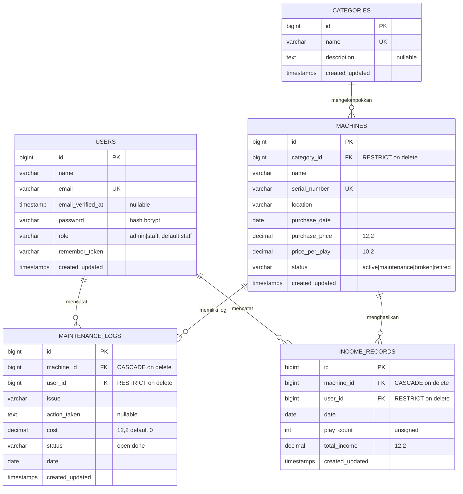

# ERD — Entity Relationship Diagram

Sumber kebenaran: file migration di `database/migrations/`. Semua foreign key dideklarasikan eksplisit dengan aturan hapus (`restrict` / `cascade`).

## Diagram



> Tabel framework pendukung: `sessions` (driver session database), `password_reset_tokens`, dan `migrations` — tidak berelasi dengan entitas bisnis.

## Penjelasan Relasi

| Relasi | Kardinalitas | Aturan hapus | Alasan |
|---|---|---|---|
| `categories` → `machines` | one-to-many | **RESTRICT** | Kategori yang masih dipakai mesin tidak boleh dihapus; controller menangkap `QueryException` dan menampilkan pesan ramah (lihat `CategoryController::destroy`). |
| `machines` → `maintenance_logs` | one-to-many | **CASCADE** | Riwayat perawatan melekat pada mesin; mesin dihapus → riwayatnya ikut terhapus. |
| `machines` → `income_records` | one-to-many | **CASCADE** | Sama seperti log perawatan: catatan pendapatan tidak bermakna tanpa mesinnya. |
| `users` → `maintenance_logs` / `income_records` | one-to-many | **RESTRICT** | Jejak data siapa yang mencatat harus terjaga; user yang masih punya catatan tidak bisa dihapus (`UserController::destroy` menampilkan pesan error ramah). |

## Memanggil Relasi via Eloquent

```php
// Dari sisi "one" ke "many"
$category->machines;                    // App\Models\Category::machines()
$machine->maintenanceLogs;              // App\Models\Machine::maintenanceLogs()
$user->incomeRecords;

// Dari sisi "many" ke "one"
$maintenanceLog->machine->name;         // App\Models\MaintenanceLog::machine()
$incomeRecord->user->name;

// Eager loading untuk mencegah N+1 query (dipakai di semua index controller)
Machine::with('category')->paginate(10);
IncomeRecord::with(['machine', 'user'])->get();
```
