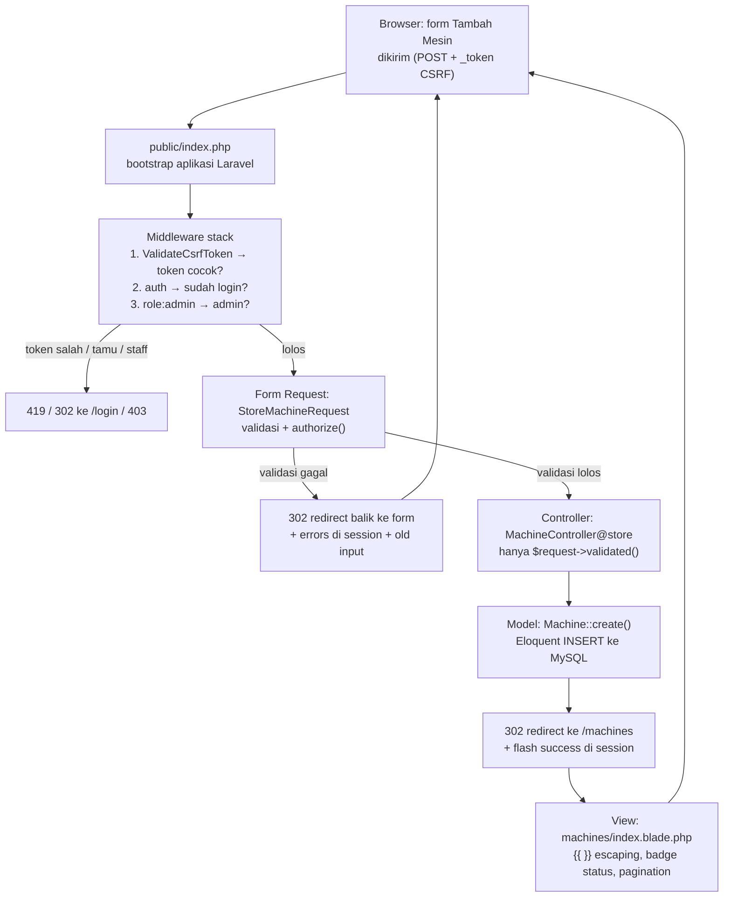
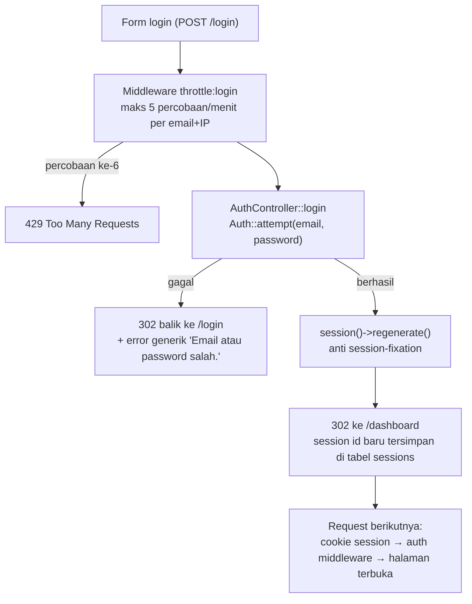

# Alur Permintaan (Request Lifecycle)

Dua alur utama yang dipakai sebagai bahan jawaban esai: **(1)** siklus tambah data (MVC lengkap) dan **(2)** autentikasi & session.

## 1. Siklus MVC — Contoh: Tambah Mesin (`POST /machines`)

Peran setiap lapisan (bukti di kode):

| Lapisan | File | Tanggung jawab |
|---|---|---|
| Routing | `routes/web.php` | `Route::resource('machines', ...)->only(['create','store','destroy'])->middleware('role:admin')` |
| Middleware | `app/Http/Middleware/RoleMiddleware.php` | tolak non-admin dengan 403 |
| Validasi | `app/Http/Requests/StoreMachineRequest.php` | aturan + pesan error bahasa Indonesia |
| Controller | `app/Http/Controllers/MachineController.php` (`store`) | `Machine::create($request->validated())` — tidak pernah `$request->all()` |
| Model | `app/Models/Machine.php` | `$fillable` (mass-assignment guard), relasi, cast `decimal:2` / `date` |
| View | `resources/views/machines/index.blade.php` | tabel + pencarian + badge status + pagination |

## 2. Autentikasi & Session — Login (`POST /login`)

Poin keamanan pada alur ini:

- **Session driver `database`** — data session disimpan di tabel `sessions`, bukan file; `SESSION_DRIVER=database` (lihat `.env.example`).
- **Session fixation** — `session()->regenerate()` saat login; logout memakai `invalidate()` + `regenerateToken()`.
- **Password** — diverifikasi via `Hash`/bcrypt (`Auth::attempt`), tidak pernah dibandingkan sebagai string.
- **Kontrol akses berlapis** — `auth` middleware (sudah login?) → `role` middleware (admin?) → Policy (pemilik data?) → Form Request `authorize()`. Lihat [`roles.md`](roles.md) untuk matriks lengkap.
